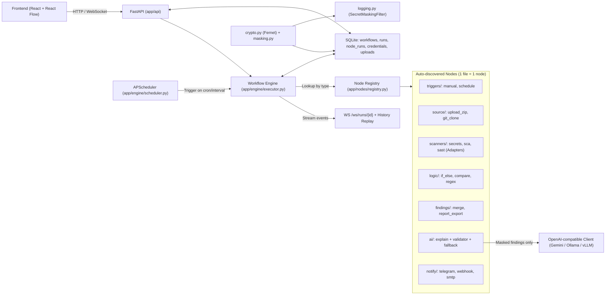

# Архитектура «AI Security Workflow»

## Общая схема

## Принцип расширяемости (1 файл = 1 нода)
`app/nodes/registry.py` автоматически сканирует все модули внутри `app/nodes/` через `pkgutil.walk_packages`.  
Чтобы добавить новую ноду (например, `notify.webhook`), достаточно создать файл в `app/nodes/notify/webhook.py` с классом-наследником `BaseNode` и декоратором `@register_node`. Изменения в `executor.py`, `graph.py`, `registry.py` или `api/` не требуются — новая нода сразу появляется в `GET /api/node-types` и исполняется движком.

## Поток выполнения DAG и ветвления
1. При сохранении (`POST/PUT /api/workflows`) `graph.py` проверяет:
   - отсутствие циклов (Kahn topological sort);
   - наличие ровно одного триггера в каждой связной компоненте графа;
   - совместимость типов портов (`Workspace`, `Findings`, `Report`, `Any`);
   - валидность `params` по Pydantic-схеме каждой ноды.
2. `executor.py` выполняет ноды в топологическом порядке с `asyncio.wait_for(..., timeout=NODE_TIMEOUT_SECONDS)`:
   - блокирующие операции (распаковка zip, `git clone`, сканеры) выносятся в `asyncio.to_thread`;
   - ветвящие ноды (`logic.*`) возвращают данные только на активный выходной порт (`true` или `false`), а нижестоящие ноды неактивного порта получают статус `skipped`;
   - падение отдельной ноды изолируется (`failed`), зависимые ветки становятся `skipped`, независимые ветки продолжают выполнение (`partial`).
3. Рабочая директория `/tmp/runs/{run_id}` очищается по завершении запуска; постоянные отчёты `report.json` и `report.md` сохраняются в `ARTIFACTS_DIR/{run_id}`.

## Границы безопасности и приватности
- **Секреты (credentials):** шифруются Fernet; ключ берётся из `APP_SECRET_KEY` или сохраняется с правами `0600` вне репозитория (`~/.ai_security_workflow_secret.key`). API возвращает только `"****"` и последние 2–4 символа.
- **Логи и WebSocket:** `SecretMaskingFilter` и `RunEventBroker` маскируют все расшифрованные секреты и токен-паттерны.
- **LLM:** получает только маскированные метаданные `Finding`, никогда исходный код или сырые секреты.
- **Валидатор AI (`app/nodes/ai/validator.py`):** проверяет JSON-схему, существование `finding_ref`, совпадение упомянутых файлов/строк, фильтрует выдуманные `CVE`/`GHSA`; при сбое делает 1 повторную попытку, затем строит детерминированный fallback-отчёт.
- **Источники кода:** `source.upload_zip` блокирует zip-slip, симлинки и бомбы; `source.git_clone` разрешает только `https://` URL из `GIT_CLONE_ALLOWLIST`.
